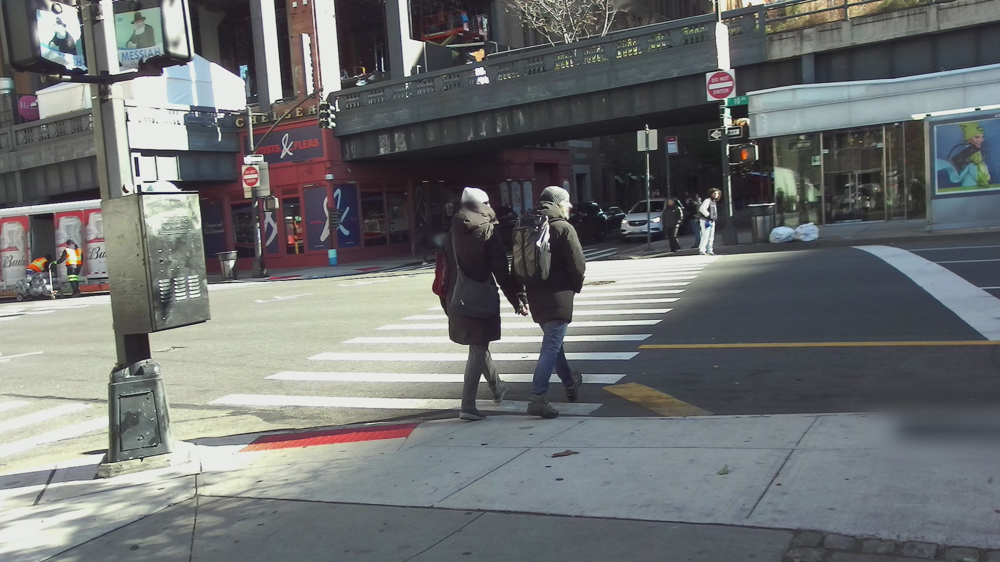
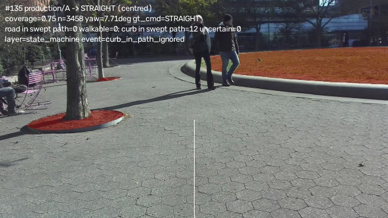
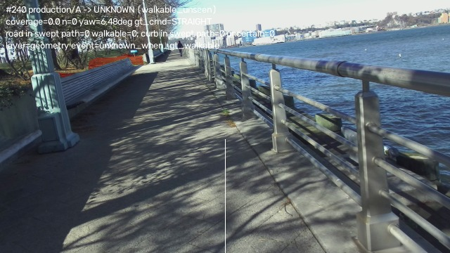

# P1 Path Keeper — where corridor truth is lost (four-arm SANPO-Real diagnostic)

Ticket: Issue #14, "P1 Path Keeper: measure where corridor truth is lost (diagnostic only)".
Date: 2026-11-06. Branch: `agent/corridor-diagnostic-harness-555fe4c2d00e` (from
`feature/shadowwalk-protocol`). Evidence level: **DESKTOP_REAL_DATA** — offline PC run on
SANPO-Real frames, CPU/MPS. Not device-verified, not user-tested. BlindNav is not a
certified mobility aid; nothing here is a safety claim.

This change adds measurement only. No corridor algorithm, segmentation model, depth model
or threshold was changed or tuned.

## 1. Problem

On ordinary pavement the walking corridor reports a false-safe (Road-as-Sidewalk) rate of
14–16 % and a curb recall of 31.6 % (segmentation-eval numbers, `docs/BLINDNAV_TECH_ROUND2.md`).
Nobody has established whether that error starts in the segmentation mask or in the corridor
geometry/decision built on top of it, so threshold and model rounds have been guesses. This
ticket builds the measurement that splits the layers, and reports where truth is lost first.

## 2. Evidence before this change

Prior evidence, all existing repository reports (no new numbers):

* v5 segmentation on `real_v2` (120 annotated SANPO frames): Road-as-Sidewalk 16.5 %
  (`road false-safe`), curb recall 0 % for v5 alone and 31.6 % only with the v6 boundary
  ensemble, "valid corridor" 95 % (`docs/BLINDNAV_TECH_ROUND2.md`).
* Existing corridor stub on 200 real GT walkable masks with a synthetic centred pose:
  STRAIGHT 87 (43.5 %), LEFT 36 (18 %), RIGHT 61 (30.5 %), UNKNOWN 16 (8 %)
  (`pc/out/blindroad_shadowwalk/centred_pose/summary.md`). The existing tool counts
  "spurious turn" only when walker offset, visible-band offset *and* yaw are all inside the
  deadbands, so this LEFT/RIGHT traffic was not attributed to a layer.
* Production-style PC pipeline on the same three SANPO-Real sessions: UNKNOWN 48 %,
  SAFE coverage 11 %, depth AbsRel 0.762 with pose-derived gravity; with GT ground gravity,
  UNKNOWN 5 %, SAFE coverage 29.5 % (`pc/out/real_eval/summary.md` (local artifact, not committed)). That run had no
  segmentation ablation, and no attribution of first-loss layer.

What was missing: the same real frames, the same corridor algorithm, and only the
segmentation (and boundary uncertainty) varied, with explicit numerators/denominators.

## 3. What was built

`pc/tools/corridor_truth_eval.py` (new, measurement only) plus
`pc/tests/test_corridor_truth_eval.py` (unit tests for the label remap, arm masks,
physical uncertain band, route-tangent/rotation logic and the num/den aggregation).

The tool runs the existing corridor algorithm (`blindnav_pc.shadowwalk.ShadowWalkTracker`,
unchanged config) on the three local SANPO-Real sessions and compares four arms:

| arm | corridor input |
|---|---|
| A | human-annotated segmentation (SANPO labels remapped exactly like the v5 training labels: SAFE = sidewalk/crosswalk/paved trail/other walkable) |
| B | v5 predicted segmentation (team SegFormer-B0 SANPO fine-tune, 5 classes) |
| C | A + uncertain band along the walkable/road boundary |
| D | B + the same uncertain-band construction |

The band marks pixels within a **physical 0.25 m ground distance** of the arm's own
walkable-region boundary (morphological gradient plus the arm's own BOUNDARY-class pixels);
the pixel radius comes from the arm's metric depth, not a hand-picked pixel width. 0.25 m is
the corridor stub's existing lateral deadband constant (`ShadowWalkConfig.deadband_m`), reused
as a ground tolerance — it was not tuned.

Two geometry inputs are reported side by side:

* **production geometry** — Depth-Anything-V2-Small inverse depth + the existing per-frame
  `GroundCalibrator` with the pose-derived gravity proxy (the deployment-like chain);
* **oracle geometry** — GT depth + GT ground-plane up vector and camera height. This is a
  diagnostic ablation that removes depth/gravity error so the corridor construction itself
  can be scored. It is never a system input.

Corridor/pose setup (the real sessions ship no route file): the corridor centreline is the
recorded route itself — the VIO pose trajectory projected on the local horizontal plane
(`fixed_camera_poses.csv`). The route tangent is a total-least-squares line over ±4 m of
path arclength; the walker therefore sits on the corridor centreline by construction, and
any LEFT/RIGHT is a correction the system invented rather than one needed to follow the
route. Yaw error is camera heading minus route tangent, so a body/camera rotation that does
not change the walking direction is the "phone rotation → LEFT/RIGHT" proxy.

### Metrics (all with numerator and denominator)

| metric | definition |
|---|---|
| Road-as-Sidewalk (RAS) | Of GT road ground points in the near field the guidance is about (1.5–10 m forward, ±3 m lateral; GT geometry, stride-4 points, ground-plane gate), the share the arm's corridor mask labels walkable. |
| curb recall | Of GT curb/boundary ground points in the corridor band (1.5–6 m, half width + margin), the share the arm marks uncertain (inside its uncertain band). A/B have no uncertainty channel by construction — the current corridor consumes a binary walkable mask and discards the boundary label. |
| corridor coverage | Share of frames whose forward-bin coverage reaches the stub's existing `min_coverage` 0.5 (1.5–6 m, 1.0 m bins, ≥5 walkable points/bin). Mean coverage is in `summary.json`. |
| wrong-correction count | LEFT/RIGHT emitted when the camera heading rotated ≥6° within 1 s while the route tangent turned ≤2° and the yaw rule (not the lateral-band rule) fired — the existing walking state machine's 6°/1 s rotation-suspicion threshold. All LEFT/RIGHT and the band-driven subset are reported separately. |
| UNKNOWN rate | UNKNOWN output frames / frames. |

Additional event flags (explicit, fixed a priori, reported with counts): a **road-in-path
ignored** frame has ≥5 GT road points in the swept-body corridor (1.5–6 m, |lateral| ≤0.6 m
= 0.3 m body half width + 0.3 m margin) while the corridor still says STRAIGHT; a
**curb-in-path ignored** frame is the same for GT curb points (2.5–6 m) and STRAIGHT;
**unknown when GT walkable** means UNKNOWN while ≥50 GT walkable ground points are inside
the corridor band.

## 4. Data and conditions

* `pc/data/sanpo_real/sanpo-real` — all three sessions, all downloaded frames, chest camera,
  every 5th frame of 15 fps video (≈0.33 s between frames): **481 frames** total
  (`-PqSD…` 121, `UGNw…` 176, `M5UI…` 184). 2.0 GB local, already present; no synthetic
  fallback, no missing data.
* RGB is resized to 640 px wide for the models and the harness (K scaled accordingly); GT
  depth (CREStereo pseudo-GT) and GT segmentation are scored at that size.
* v5 checkpoint: local `blindnav-real-eval/models/segformer_sanpo_b0_v5.pt`
  (not committed; `*.pt` is gitignored). Loaded exactly as the existing
  `tools/eval/scripts/train_sanpo_segformer.py` / `eval_segformer_v2.py` recipe (5 classes).
* Depth-Anything-V2-Small and the existing ground calibrator for production geometry;
  pose-derived gravity via the existing `orientation_to_gravity_heading` convention.
* Fixed seeds, no random sampling; the same frames, same order, same corridor config for
  all four arms and both geometry inputs.

## 5. Results

### 5.1 Five-metric table, production geometry (primary)

481 frames per arm, identical frames/conditions.

| arm | Road-as-Sidewalk | curb recall | coverage ≥0.5 | UNKNOWN | wrong corrections (rotation→LR) | band-driven LEFT/RIGHT |
|---|---:|---:|---:|---:|---:|---:|
| A annotated | **0/52 197 (0.0 %)** | **0/35 199 (0.0 %)** | **394/481 (81.9 %)** | **18.3 %** (88/481) | 1 | 160 |
| B v5 | **26 944/52 197 (51.6 %)** | 0/35 199 (0.0 %) | 375/481 (78.0 %) | 22.2 % (107/481) | 1 | 173 |
| C A+band | 0/52 197 (0.0 %) | **35 199/35 199 (100.0 %)** | 377/481 (78.4 %) | 22.0 % (106/481) | 1 | 152 |
| D B+band | **19 602/52 197 (37.6 %)** | **28 069/35 199 (79.7 %)** | 366/481 (76.1 %) | 23.9 % (115/481) | 2 | 152 |

### 5.2 Same table, oracle geometry (depth/gravity ablation)

| arm | Road-as-Sidewalk | curb recall | coverage ≥0.5 | UNKNOWN | wrong corrections (rotation→LR) | band-driven LEFT/RIGHT |
|---|---:|---:|---:|---:|---:|---:|
| A annotated | 0/52 197 (0.0 %) | 0/35 199 (0.0 %) | 470/481 (97.7 %) | 2.3 % (11/481) | 2 | 201 |
| B v5 | 26 944/52 197 (51.6 %) | 0/35 199 (0.0 %) | 468/481 (97.3 %) | 2.7 % (13/481) | 2 | 197 |
| C A+band | 0/52 197 (0.0 %) | 35 199/35 199 (100.0 %) | 463/481 (96.3 %) | 3.7 % (18/481) | 2 | 303 |
| D B+band | 17 808/52 197 (34.1 %) | 33 456/35 199 (95.0 %) | 464/481 (96.5 %) | 3.5 % (17/481) | 3 | 283 |

Reading the table:

* **A vs B isolates segmentation.** Annotated segmentation removes Road-as-Sidewalk
  entirely (0/52 197 vs 26 944/52 197). v5 labels **51.6 %** of near-field GT road ground
  points walkable, over double the 16.5 % full-image real_v2 number — the near field where
  the user is being guided is a harder sub-region than the whole image. The band reduces
  this to 37.6 % (production) / 34.1 % (oracle) in D but cannot remove road-interior
  false-safe blobs: the residual is still a third of near-field road points.
* **C vs A and D vs B isolate the band.** The band buys curb-boundary awareness
  (A/B = 0 by construction; C = 100 %, D = 79.7 % production / 95.0 % oracle), but it also
  costs command agreement and adds corrections — see 5.3.
* **Production vs oracle geometry isolates the geometry layer.** With the same annotated
  segmentation, coverage falls from 470/481 (97.7 %) to 394/481 (81.9 %) and UNKNOWN rises
  from 2.3 % to 18.3 %. No segmentation or corridor-decision change can produce that gap;
  it is the depth/gravity/calibration chain. Most of the loss (77/102 A failures) is
  UNKNOWN while annotated walkable ground is present.

### 5.3 Corridor decisions, events and per-session splits

Command agreement with the annotated-mask corridor under oracle geometry (the same
algorithm fed GT mask + GT geometry, arm A oracle = reference): **B 418/481 (86.9 %),
C 328/481 (68.2 %), D 345/481 (71.7 %)** in oracle geometry. In production geometry, arm A
itself agrees with that reference on only 280/481 (58.2 %) frames — the geometry chain
changes the command without any segmentation difference.

Per-session UNKNOWN (production geometry), showing where geometry loss concentrates:

| session | frames | A | B | C | D | road pixels present |
|---|---:|---:|---:|---:|---:|---|
| `-PqSD…` | 121 | 24.8 % | 27.3 % | 28.9 % | 28.9 % | yes (all 52 197 near-field road points) |
| `UGNw…` | 176 | 31.2 % | 39.2 % | 38.6 % | 42.0 % | no GT road pixels in the session |
| `M5UI…` | 184 | 1.6 % | 2.7 % | 1.6 % | 3.3 % | no GT road pixels in the session |

The GT road pixels used by Road-as-Sidewalk occur in **one session only**; the curb and
geometry results cover all three. This is reported rather than hidden: the RAS denominator
is one session's 121 frames, not 481.

Event counts (production geometry; oracle geometry in `summary.json`):

| arm | failing frames | first-layer attribution (seg / geometry / motion / state machine) | failure events |
|---|---:|---|---|
| A | 102 | 0 / 53 / 1 / 48 | unknown-when-GT-walkable 77, curb-in-path ignored 24, rotation-wrong-correction 1 |
| B | 114 | 3 / 59 / 1 / 51 | unknown-when-GT-walkable 96, curb-in-path ignored 15, road-in-path walkable 2, rotation 1 |
| C | 125 | 0 / 65 / 1 / 59 | unknown-when-GT-walkable 95, curb-in-path ignored 29, rotation 1 |
| D | 122 | 3 / 64 / 2 / 53 | unknown-when-GT-walkable 104, curb-in-path ignored 14, road-in-path walkable 2, rotation 2 |

Under **oracle geometry**, arm A drops to 25 failing frames (state machine 23, motion 2;
curb-in-path ignored 21, road-in-path ignored 2). This is the important pair: with
annotation and perfect geometry, segmentation is no longer the losing layer, yet the
corridor still emits walkable guidance while annotated road/curb lies in the swept path.

## 6. Where the truth is lost first

Two different failure directions must not be conflated:

### 6.1 Truth lost toward FREE (false-safe) — the safety-relevant direction

1. **Segmentation is the first losing layer for v5 (arm B/D).** It is the earliest stage
   where the truth changes: 26 944/52 197 near-field GT road ground points are labelled
   walkable (51.6 %). At command level this directly appears as
   `road-in-path walkable` frames — road inside the swept-body corridor, output STRAIGHT
   (2 frames in B, 2 in D, 0 in A/C frames of this kind). The annotated mask removes this
   channel completely.
2. **Once segmentation is annotated (A/C), the corridor is still the first losing layer —
   the decision/state-machine representation.** The corridor stub consumes only walkable
   points. A road or curb that the mask correctly excludes is not "non-walkable evidence";
   it simply contributes nothing. The output is decided by "are there enough walkable
   points?", so correctly-labelled obstacles cannot make the corridor BLOCKED/UNKNOWN.
   With GT mask + GT geometry the arm A still has 21 curb-in-path and 2 road-in-path
   frames where the output was walkable guidance. The band arms re-introduce *some*
   boundary uncertainty but not an obstacle channel: C still has 24–29 curb-in-path
   ignored frames, and its band increases corrections (303 vs 201 band-driven LEFT/RIGHT
   under oracle geometry) and reduces command agreement (68.2 % vs 100 % for A).
3. **Motion estimation** is only a minor direct contributor in this data: 20 rotation-only
   frames in 481, 1–3 rotation-triggered LEFT/RIGHT per arm. Combining a body rotation with
   a stable route does happen, but it is rare in chest-mounted SANPO data.

### 6.2 Truth lost toward UNKNOWN (conservative) — the coverage direction

**Geometry is the first losing layer for coverage.** With annotated segmentation the
production chain (Depth-Anything-V2-Small + pose-derived gravity + ground calibration) loses
walkable ground: 53/102 A failures are geometry, coverage 81.9 % vs 97.7 %, UNKNOWN 18.3 %
vs 2.3 % under oracle geometry. 12/121 frames in `-PqSD…` fail calibration outright at
session start; the rest are walkable points projected outside the 0.15 m ground band by
residual depth/gravity error. This direction is conservative (UNKNOWN, not FORWARD), so it
is a usability loss rather than a false-safe loss.

**Answer to "classify the first layer where a real obstacle becomes FREE":**
segmentation, for the v5 arms (road→walkable is created there); for an annotated
segmentation the first layer is the **corridor decision/state-machine representation**,
because a correctly excluded road/curb is not passed to the decision as non-walkable
evidence. Geometry is the first layer only for the opposite (UNKNOWN) direction. Motion is
third-order in this dataset.

## 7. Concrete failing frames

Full-size raw RGB plus annotated overlay for each frame are in
`assets/corridor_truth_20261106/failures/` (filenames below; raw frames are the original
SANPO frames, overlays add GT walkable/road tint, the uncertain band where applicable, and
the per-frame numbers). Source: `pc/data/sanpo_real/sanpo-real`, production geometry unless
stated. The same set is machine-readable in `assets/corridor_truth_20261106/failures/failures.json`.

| # | arm/mode | session | frame | output | layer | what is lost |
|---|---|---|---:|---|---|---|
| f01 | B / production | `-PqSD…` | 470 | STRAIGHT | segmentation | road in swept path; v5 calls the near-field road walkable (GT road tinted red, GT mask excludes it) |
| f02 | B / production | `-PqSD…` | 495 | STRAIGHT | segmentation | second road-in-path frame; same v5 Road-as-Sidewalk channel |
| f03 | A / production | `-PqSD…` | 135 | STRAIGHT | state machine | annotated curb in swept path (12 GT curb points), corridor still says straight |
| f04 | A / production | `UGNw…` | 35 | STRAIGHT | state machine | curb in swept path ignored by the walkable-only corridor input |
| f05 | B / production | `-PqSD…` | 155 | LEFT | motion | camera heading rotates ≥6°/s while the route tangent turns <2°; yaw rule emits LEFT |
| f06 | A / production | `M5UI…` | 240 | UNKNOWN | geometry | walkable promenade clearly visible; production depth/gravity calibration projects too few ground points, corridor UNKNOWN |
| f07 | A / production | `M5UI…` | 350 | UNKNOWN | state machine | enough GT walkable ground but forward-bin coverage below 0.5; UNKNOWN although annotated walkable band is continuous forward |

Illustration of the C band construction (arm C, oracle geometry, frame 135): orange is the
physical 0.25 m uncertain band; GT curb points are covered (curb recall 100 % in C) but the
band shifts the visible-band median enough to emit RIGHT where the GT-mask corridor says
STRAIGHT — the command-agreement cost of the band.
``







## 8. Recommendation (one change, with falsifying evidence)

**Next change: give the corridor decision an explicit non-walkable-ground evidence channel
instead of deciding from "enough walkable points" alone** — i.e. pass the
road/curb/obstacle points that the segmentation excludes into the corridor decision so that
a correctly-labelled non-walkable surface inside the swept path can raise UNKNOWN/BLOCKED
(the corridor geometry/state-machine layer, not the segmenter, not the thresholds). This is
a corridor-algorithm change and is **Level B**: it is proposed here, not implemented, and
needs a human technical decision before adoption.

Why this layer, not thresholds: with annotated segmentation and GT geometry (the best case
the segmenter can ever give), the corridor still emitted walkable guidance while annotated
road/curb lay in the swept-body path in 23/481 frames (21 curb + 2 road), and the
uncertainty-band construction did not remove that class (C: 24–29 curb-in-path ignored
frames) while costing command agreement. Threshold tuning of the existing walkable-only
representation cannot see those points at all.

**What would falsify the recommendation:** if annotated segmentation + oracle geometry
produced **zero** frames with GT road/curb inside the swept-body corridor while the output
was STRAIGHT/LEFT/RIGHT, then the corridor representation would not be losing the truth and
the next change should instead be the segmentation (v5 Road-as-Sidewalk fine-tune) —
measured here: 23 such frames, so the recommendation stands. A second falsifier: if a
band-only construction recovered those frames without extra corrections/coverage loss, the
band would be sufficient — measured: it did not (C 24–29 ignored frames, band corrections up
to 303/481, command agreement down to 68.2 % vs 100 %).

Secondary (not the recommendation, because it is the conservative direction): the
production depth/gravity/calibration chain loses annotated walkable ground and should be
revisited after the corridor representation decision; that is the geometry layer measured
in 5.2 and 6.2, not a safety-false-clear channel.

## 9. Regression

* No production code path is modified. The new files are one tool and one test module;
  existing `pc/` behaviour is unchanged. Full `pc/` test suite result is in the PR
  (pytest, plus the new 11 tests).
* The harness is deterministic (fixed seeds, no random sampling) and its machine summary
  is committed as `summary.json`, `metrics.csv`, `per_frame.csv`, `summary.md` next to this
  report.
* No dataset/version change: the frozen SANPO-Real sessions are read in place
  (`pc/data/` is gitignored); nothing is re-uploaded or edited.

## 10. Remaining risks and NOT_EVALUABLE items

* **NOT_EVALUABLE — device/user safety.** No phone, no device IMU, no blind-user session.
  All numbers are DESKTOP_REAL_DATA on SANPO-Real (chest-mounted ZED VIO pose used as an
  IMU proxy). No safety claim.
* **NOT_EVALUABLE — true phone rotation.** SANPO is chest-mounted; camera heading is body
  heading. "Phone rotation → LEFT/RIGHT" is only measurable as camera heading rotating
  while the route does not turn; that proxy fires in 20/481 frames. Device-in-hand rotation
  behaviour is not measurable from this data.
* **NOT_EVALUABLE — production curb-recall gate.** The production protocol
  (`docs/REAL_DEVICE_PROTOCOL.md`) defines per-instance curb recall from height diff ≥8 cm
  and a non-FORWARD output within 1.5 m. Here "curb recall" is boundary-class uncertainty
  coverage of GT curb *points*; it is a representation metric, not the gate. The chest
  camera also does not see ground closer than ≈3 m, so curbs nearer than that cannot be
  detected from a single frame; curb-in-path events were measured at 2.5–6 m only.
* **Road-as-Sidewalk denominator is one session.** GT road pixels only appear in
  `-PqSD…` (121 frames). The near-field ROI definition differs from the full-image
  real_v2 number in `BLINDNAV_TECH_ROUND2.md`; the two percentages are not directly
  comparable.
* **Route-from-recorded-walk assumption.** Corridor centreline = the recorded VIO walk.
  This makes "walker left the route" unmeasurable and makes LEFT/RIGHT commands
  by construction unnecessary for route following; band-driven corrections therefore are
  an upper bound for "unnecessary corrections" and can include legitimate centring advice
  in a real route-following task.
* **Depth is CREStereo pseudo-GT in the oracle arm** and Depth-Anything-V2-Small in the
  production arm; neither is sensor truth. The oracle arm is an ablation, never a system
  input.
* **Calibration warm-up**: 12/121 `-PqSD…` frames fail calibration at session start and
  are scored as geometry failures; this slightly over-weights the geometry layer in that
  session.
* The band width 0.25 m is one fixed design constant (from the existing deadband), not a
  tuned value; its sensitivity was not swept, deliberately, to avoid threshold tuning.

## 11. Reproduction

```bash
cd pc
# models are local and deliberately not committed (pc/out/, pc/data/, *.pt gitignored)
export HF_HUB_OFFLINE=1 TRANSFORMERS_OFFLINE=1
.venv/bin/python tools/corridor_truth_eval.py \
    --v5-checkpoint ../blindnav-real-eval/models/segformer_sanpo_b0_v5.pt \
    --data-root data/sanpo_real/sanpo-real \
    --out out/corridor_truth_full --save-failures
# unit tests
.venv/bin/python -m pytest tests/test_corridor_truth_eval.py -q
```

The committed machine summary in `assets/corridor_truth_20261106/` was produced with
`--out out/corridor_truth_full --save-failures --failures-limit-per-kind 2 --failures-max 12`;
run time ≈3 min on the M1 MPS machine. `summary.json` carries the exact meta
(thresholds, band width, arm descriptions, frame counts).
