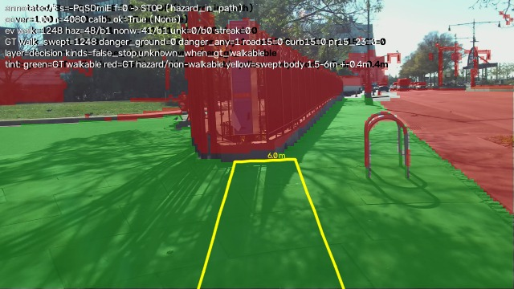
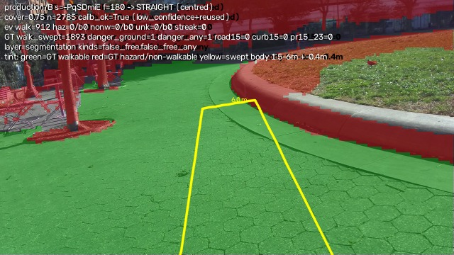
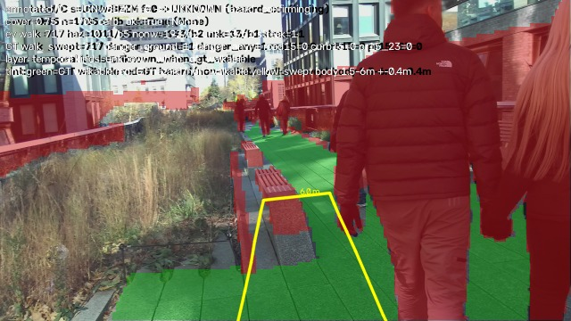

# P1 Path Keeper — negative-evidence fusion in the corridor decision layer (A/B/C on SANPO-Real)

Ticket: Issue #16, "P1 Path Keeper: implement negative-evidence fusion in the corridor decision
layer". Date: 2026-11-06. Branch: `agent/negative-evidence-fusion-9bf4ca1477ca`, stacked on PR #15
head and opened against `feature/shadowwalk-protocol` (open for operator adoption; never merged by
the agent). Evidence level: **DESKTOP_REAL_DATA** — offline PC run on SANPO-Real frames, CPU/MPS.
Not device-verified, not user-tested. BlindNav is not a certified mobility aid; nothing here is a
safety claim.

## 1. Problem

PR #15 showed that the corridor decision layer consumes only walkable points: a correctly excluded
road or curb contributes nothing to the decision, so it cannot raise UNKNOWN/STOP. With annotated
segmentation and reference geometry the corridor still emitted walkable guidance while GT road or
curb lay inside the swept-body corridor in **23/481 frames** (21 curb + 2 road). That is a
representation defect in the decision layer, not a segmentation/threshold problem: with perfect
inputs the truth was already lost by the time the decision was made. This ticket implements the
change PR #15 recommended and measures it before/after on the same frames.

## 2. Evidence before (PR #15, unchanged, all existing repository reports)

* Same 481 SANPO-Real frames (three sessions: `-PqSD…` 121, `UGNw…` 176, `M5UI…` 184), chest
  camera, every 5th frame.
* Production geometry (DAV2 + pose-derived gravity + ground calibration): arm A annotated
  segmentation emitted walkable guidance while GT road/curb was inside the swept path in
  `road-in-path 2 + curb-in-path 24` frames; UNKNOWN `88/481 (18.3 %)`; corridor coverage
  `394/481 (81.9 %)`.
* Oracle geometry (GT depth + GT plane, diagnostic only): annotated segmentation failed on 25
  frames — **21 curb-in-path + 2 road-in-path + 2 rotation**; the band construction (PR #15 arms
  C/D) did not remove that class (24–29 curb-in-path frames) and cost 303/481 band-driven
  corrections and command agreement down to 68.2 %.
* v5 segmentation labelled 51.6 % of near-field GT road ground points walkable (Road-as-Sidewalk),
  which is a segmentation-layer defect this ticket does not retrain; it bounds what the production
  arm can achieve.

Falsifier stated by PR #15: if annotated segmentation + oracle geometry produced zero road/curb-in-
swept-path frames, the representation would not be losing truth. It produced 23, so the change was
justified.

## 3. Change (what was built)

Two files change the corridor decision layer; two new tools measure it; nothing else in the
production pipeline changes.

**`pc/blindnav_pc/corridor_evidence.py` (new).** An explicit four-channel evidence structure for
the corridor map frame (x right, z forward, metres):

| channel | definition |
|---|---|
| `walkable` | ground points (|height| <= 0.15 m) whose mask says walkable |
| `hazard` | curb/boundary-class ground points + blocking obstacle points (0.15 m < height <= 2.0 m) that the mask does not call walkable |
| `non_walkable` | excluded ground points (road, terrain, grass/other excluded ground classes) |
| `unknown` | unlabelled ground + geometric conflicts (mask says walkable but the point is not ground) |

`build_corridor_evidence(role_map, depth, K, up, camera_height_m, pose, ...)` back-projects the
role map with the existing `depth_to_level_points` helper and returns the four map-frame point
sets. Its `walkable` channel is row-for-row identical to the existing
`mask_to_map_points` output, so arm B/C do not change the walkable input — they only add
counter-evidence. The existing class taxonomy is reused unchanged (v5 ids 0 ignore / 1 SAFE /
2 BOUNDARY / 3 CONDITIONAL / 4 NON; SANPO GT is remapped with the same `gt_remap` used by PR #15),
so `annotated` and `production` conditions share one evidence definition and are comparable.

**`pc/blindnav_pc/shadowwalk.py` (edit).** `ShadowWalkTracker` gains
`update_evidence(evidence, pose)`; `update(points, pose)` now delegates to
`update_evidence(walkable_only(points), pose)` and is regression-tested to be byte-identical to the
old behaviour. The new decision rule (a priori constants, not tuned on the eval set):

* **Swept-body gating.** The body rectangle is derived from the current heading (`Pose2D` yaw),
  human body width (`body_width_m = 0.5 m`, the existing `PlannerConfig.body_width_m`), a lateral
  safety margin (`body_margin_m = 0.15 m`, the existing `PlannerConfig.margin_m`), and the real
  forward range of the guidance (`near_m..far_m = 1.5–6.0 m`, existing). A negative point counts
  only if it is inside that rectangle; the same threshold as the existing "a bin counts as seen"
  support (`points_per_bin = 5`) decides whether a forward bin is credible. The evidence bins
  cover the inclusive 1.5–6.0 m range (five 1.0 m bins, so the 5.5–6.0 m tail is counted; this
  was fixed in review — the first revision dropped it); legacy walkable coverage keeps its
  pre-existing binning unchanged so arm A stays fixed. Road beside the pavement is therefore
  outside the body sweep and does not stop the walker.
* **Credible blocking evidence** (a swept-body bin with >= 5 hazard or non-walkable points) raises
  `STOP` with the new explainable reason codes `hazard_in_path` / `non_walkable_in_path` **before**
  the walkable-quantity branches, so enough walkable points cannot override it.
* **UNKNOWN on low confidence / conflict.** Credible unknown-channel support raises
  `unknown_evidence`; negative evidence that is present but not credible in a bin where walkable
  support is also below the support threshold raises `evidence_conflict`. Both were previously
  treated as Safe.
* **Temporal confirmation (arm C).** `temporal_confirm_frames = 3` (provenance:
  `LayerConfig.drop_confirm_frames = 3`; SANPO frames are 0.33 s apart, so ~1 s persistence):
  blocking requires 3 consecutive analysed frames with credible blocking evidence; earlier frames
  report UNKNOWN with `hazard_confirming` / `non_walkable_confirming`.
* All existing commands (LEFT/RIGHT/STRAIGHT/STOP/UNKNOWN), hint texts, reason codes, the
  `off_corridor`/`walkable_unseen`/`corridor_unseen`/`yaw_too_large`/`lateral`/`yaw`/`centred`
  branches and the STOP/MotionAuthority/ArrivalAuthority policies are unchanged.

**Measurement tools (new, no algorithm side effects).**

* `pc/tools/corridor_evidence_eval.py` runs A/B/C on the same 481 frames and the same
  corridor/pose setup as PR #15, under two input conditions:
  * `annotated`: GT SANPO segmentation (remapped exactly like the v5 training labels) + reference
    geometry (GT depth, GT ground-plane up/height). This proves the logic with the best inputs the
    segmenter can ever provide; reference geometry is a diagnostic, never a system input.
  * `production`: v5 SegFormer-B0 SANPO fine-tune + Depth-Anything-V2-Small + the existing
    `GroundCalibrator` with pose-derived gravity (the deployment-like chain). One calibrator per
    session, shared by all arms.
  GT scoring is computed once per frame with oracle geometry and raw SANPO ids, so every arm and
  condition has identical denominators. It reports primary GT **excluded-ground danger**
  (road/curb/water/inaccessible/railway/terrain >= 5 points in the decision swept body) and a
  secondary **any-negative danger** that also counts GT object/vegetation occupancy
  (0.15 m < height <= 2.0 m) in the same body; both are reported side by side so no safety number
  is one-sided.
* `pc/tools/corridor_evidence_report.py` turns the frozen eval output into per-condition A/B/C
  tables with numerator/denominator for every metric, the fixed PR #15 23-frame ledger
  (denominator 23; the set is a reporting label only and is never fed to the algorithm), per-session
  breakdowns, the B-vs-A / C-vs-B / C-vs-A deltas, and at least five remaining failure frames with
  raw RGB, annotated overlay and a mechanical failure-layer label.

## 4. Data and conditions

* `pc/data/sanpo_real/sanpo-real` — all three sessions, all downloaded frames, chest camera, every
  5th frame: **481 frames** total (`-PqSD…` 121, `UGNw…` 176, `M5UI…` 184). 2.0 GB local, already
  present; no synthetic data, no missing data, no new download.
* v5 checkpoint: local `blindnav-real-eval/models/segformer_sanpo_b0_v5.pt` (not committed; `*.pt`
  is gitignored).
* Fixed seeds, no sampling; the same frames, order, corridor config and inputs for all three arms
  and both conditions. Arm A under the annotated condition is byte-identical to PR #15's
  oracle/A rows on all 481 frames (hint, road-in-path and curb-in-path counts), which is the
  regression anchor that this is the same measurement, not an easier dataset.
* The decision rule and every constant were frozen in the branch before the official run; no
  parameter or threshold was tuned against measured results. The input-condition split and the
  per-session breakdown below are the validation slices; a truly independent real clip and any
  device/user truth are NOT_EVALUABLE here.

## 5. Results

All numbers below are from one deterministic run over the same 481 frames and identical
inputs/denominators per condition, after the review-fixed inclusive far-bin evidence counting
(see §3 and §9). Machine-readable: `summary.json`, `metrics.csv`, `per_frame.csv`
(2 886 rows = 481 frames x 2 conditions x 3 arms) and `report_tables.md/.csv` in
`docs/assets/path_keeper_negative_evidence_20261106/`. `pr15_23` was recovered as exactly 23
frames and verified on the full run; PR #15 in-path event frames = 114.

Two GT danger denominators are reported side by side because a single one would be one-sided:

* **primary / GT excluded-ground danger** — the PR #15 first-loss class: GT non-walkable ground
  points (road, curb, water, inaccessible, railway, terrain; raw SANPO ids) >= 5 in the decision
  swept body. 103/481 frames.
* **secondary / GT any-negative danger** — primary plus GT object/vegetation occupancy
  (0.15 m < height <= 2.0 m) and GT non-walkable-class ground >= 5 in the swept body. 295/481
  frames.

### 5.1 `annotated` condition (GT segmentation + reference geometry — proves the logic)

| arm | false-free ground | false-free any | false-stop ground | false-stop any | UNKNOWN | guidance coverage | 23-frame W/S/U |
|---|---:|---:|---:|---:|---:|---:|---:|
| A | 92/103 (89.3 %) | 284/295 (96.3 %) | 0/378 (0.0 %) | 0/186 (0.0 %) | 11/481 (2.3 %) | 470/481 (97.7 %) | 23/0/0 |
| B | **0/103 (0.0 %)** | **6/295 (2.0 %)** | 188/378 (49.7 %) | 2/186 (1.1 %) | 0/481 (0.0 %) | 190/481 (39.5 %) | **2/21/0** |
| C | **0/103 (0.0 %)** | 6/295 (2.0 %) | 128/378 (33.9 %) | 0/186 (0.0 %) | 77/481 (16.0 %) | 190/481 (39.5 %) | 2/19/2 |

Other measured cells: danger blocking recall on the ground-danger frames **A 11/103 (10.7 %)
-> B/C 103/103 (100 %)** (B: 103 STOP; C: 86 STOP + 17 UNKNOWN); PR #15-gate false-free
78/114 (68.4 %) -> 0/114 (0.0 %); mean walkable coverage unchanged at 0.96 and coverage>=min
unchanged 470/481; road-in-path ignored 2/5 -> 0/5 and curb-in-path ignored 21/109 -> 2/109
(PR #15 0.6 m definitions, STRAIGHT only); action flips vs A 291/481 (60.5 %) for B, 290/481
(60.3 %) for C.

### 5.2 `production` condition (v5 + DAV2 + existing ground calibration)

| arm | false-free ground | false-free any | false-stop ground | false-stop any | UNKNOWN | guidance coverage | 23-frame W/S/U |
|---|---:|---:|---:|---:|---:|---:|---:|
| A | 47/103 (45.6 %) | 208/295 (70.5 %) | 0/378 (0.0 %) | 0/186 (0.0 %) | 107/481 (22.2 %) | 374/481 (77.8 %) | 20/0/3 |
| B | **19/103 (18.4 %)** | **130/295 (44.1 %)** | 51/378 (13.5 %) | 15/186 (8.1 %) | 139/481 (28.9 %) | 251/481 (52.2 %) | **8/6/9** |
| C | **19/103 (18.4 %)** | 130/295 (44.1 %) | 28/378 (7.4 %) | 7/186 (3.8 %) | 177/481 (36.8 %) | 251/481 (52.2 %) | 8/3/12 |

Other measured cells: danger blocking recall on ground-danger frames **A 56/103 (54.4 %) -> B/C
84/103 (81.6 %)** (B: 40 STOP + 44 UNKNOWN; C: 25 STOP + 59 UNKNOWN); PR #15-gate false-free
37/114 (32.5 %) -> 13/114 (11.4 %); mean coverage unchanged 0.57 and coverage>=min unchanged
375/481; road-in-path ignored 2/5 -> 2/5, curb-in-path ignored 15/109 -> 9/109; action flips vs A
157/481 (32.6 %) for B, 144/481 (29.9 %) for C.

### 5.3 PR #15 regression frames (fixed 23 frames, denominator 23, never fed to the algorithm)

| condition | arm | of 23: walkable guidance | STOP | UNKNOWN |
|---|---|---:|---:|---:|
| annotated | A | 23 | 0 | 0 |
| annotated | B | **2** | 21 | 0 |
| annotated | C | **2** | 19 | 2 |
| production | A | 20 | 0 | 3 |
| production | B | **8** | 6 | 9 |
| production | C | **8** | 3 | 12 |

With annotated inputs the representation defect is closed for 21/23 frames in B. The 2 that remain
walkable are explainable and are not special-cased: `-PqSD…` 135 is inside PR #15's 0.6 m
map-frame band but outside this decision's 0.4 m body sweep (gate difference), and `UGNw…` 105 has
only 4 hazard-channel points in the body (below the 5-point support; its GT excluded-ground count
inside the 0.4 m body is zero). Under production inputs 8/23 remain walkable, all with zero binned
negative evidence in the v5 mask: their GT ground-danger points are either outside the 0.4 m body
sweep (PR #15's set uses a 0.6 m map-frame band) or absent from the v5 mask (Road-as-Sidewalk,
segmentation layer).

### 5.4 Temporal confirmation (C vs B)

Temporal confirmation does not change false-free at all (it cannot make B stricter): annotated
0/103 -> 0/103, production 19/103 -> 19/103. It reduces STOP and moves the difference into
UNKNOWN: annotated STOP 291 -> 214 with UNKNOWN 0 -> 77, false-stop ground 188/378 (49.7 %) ->
128/378 (33.9 %), false-stop any 2/186 -> 0/186; production STOP 91 -> 53 with UNKNOWN 138 ->
177 (28.9 % -> 36.8 %), false-stop ground 51/378 (13.5 %) -> 28/378 (7.4 %), false-stop any
15/186 -> 7/186. Guidance coverage is unchanged in both conditions because blocked frames become
UNKNOWN instead of walkable.

### 5.5 Per-session validation slice (including the session with no GT road/curb danger)

The rule and every constant were frozen before this run; no threshold was changed in response to
these numbers. The per-session split is the available validation view (all cells in
`report_tables.md` §2):

* `-PqSD…` (121 frames, the only session with GT road points): annotated A false-free ground
  10/21 -> B/C 0/21; B STOP 43/121 (guidance 78/121), C STOP 29 + 14 UNKNOWN.
* `UGNw…` (176 frames, curb-heavy): annotated A false-free ground 82/82 (100 %) -> B/C 0/82;
  but B STOP 162/176 and guidance coverage 14/176 — the over-conservative cost is concentrated
  here.
* `M5UI…` (184 frames, **zero** GT road/curb ground-danger frames — the PR #15 clean session):
  annotated A false-free 0/0, guidance 184/184; B still STOPs 86/184 (46.7 %) and loses guidance
  on those frames even though there is no ground danger at all; all of those STOPs are carried by
  object/vegetation occupancy (danger_any) evidence. This is the clearest validation of the cost
  findings: the false-stop inflation is not a ground-truth road/curb artefact.
* A genuinely fresh fourth real clip was not available: the raw SANPO-Real download has more
  sessions but no preprocessed depth/segmentation/pose in this repository, and adding one was not
  possible inside this ticket. A truly independent real clip and device/user truth are
  **NOT_EVALUABLE**.

## 6. Remaining failing frames

Ten frames from both conditions and both dimensions are committed with raw RGB and annotated
overlay in `docs/assets/path_keeper_negative_evidence_20261106/failures/`
(`failures.json` has the machine-readable manifest, counts and layer label; the fixed 23-frame
set is never special-cased). Overlay legend: green = GT walkable, red = GT hazard/non-walkable,
yellow = decision swept body (1.5–6.0 m, ±0.4 m from the current heading).

| # | kind | condition / arm | session | frame | hint / reason | layer | what still fails |
|---|---|---|---|---:|---|---|---|
| f01 | false-free (ground) | production / B | `-PqSD…` | 180 | STRAIGHT / centred | segmentation | 8 GT road/curb ground points inside the swept body but zero binned negative evidence in the v5 mask (Road-as-Sidewalk) |
| f02 | false-free (ground) | production / B | `UGNw…` | 160 | RIGHT / lateral | segmentation | 102 GT road/curb points in the body; the v5 mask still has no walkable counter-evidence to gate on |
| f03 | false-free (any) | annotated / B | `M5UI…` | 85 | STRAIGHT / centred | decision | 6 GT object-occupancy points in the body, but spread over bins with < 5 support each, so no credible negative bin |
| f04 | false-free (any) | annotated / B | `M5UI…` | 215 | LEFT / lateral | decision | same low-support case with 5 GT occupancy points below the per-bin support threshold |
| f05 | false-free (any) | production / B | `-PqSD…` | 10 | RIGHT / lateral | segmentation | 539 GT object/vegetation points in the body but no binned negative evidence from the v5 mask |
| f06 | false-free (any) | production / B | `UGNw…` | 45 | STRAIGHT / centred | segmentation | 1 071 GT object/vegetation points in the body, same v5-mask limitation |
| f07 | false-stop (ground) | annotated / B | `-PqSD…` | 0 | STOP / hazard_in_path | decision | no GT ground danger; 48 hazard + 41 non-walkable points in the body stop the walker — the over-conservative occupancy case |
| f08 | false-stop (ground) | production / B | `M5UI…` | 760 | STOP / non_walkable_in_path | decision | no GT any-negative danger; 582 non-walkable points come from v5-mask/geometry noise in the body |
| f09 | UNKNOWN when GT walkable | annotated / C | `UGNw…` | 0 | UNKNOWN / hazard_confirming | temporal | persistent curb evidence in the body; C converts the first frames of the block to UNKNOWN instead of STOP (temporal cost) |
| f10 | UNKNOWN when GT walkable | production / B | `-PqSD…` | 0 | UNKNOWN / no_metric_depth | geometry | calibration warm-up frame: no metric geometry at all, so the tracker is skipped |







## 7. What improved, what regressed, what remains NOT_EVALUABLE

**Improved (representation defect).** Under annotated segmentation + reference geometry — the best
inputs the segmenter can ever give — the corridor no longer emits walkable guidance while GT
excluded ground is inside the swept body: false-free ground danger 92/103 (89.3 %) -> 0/103
(0.0 %), blocking recall on those frames 10.7 % -> 100 %, curb-in-path ignored 21/109 -> 2/109,
PR #15-gate false-free 78/114 (68.4 %) -> 0/114, and the PR #15 23-frame regression set
23 -> 2 remaining walkable (21 STOP). The unintended "walkable-only" representation (excluded
ground contributes nothing) is replaced by an explicit four-channel structure with swept-body
gating, UNKNOWN on low confidence/conflict, explainable reason codes and no change to the existing
state machine semantics. Under production inputs the same change still reduces false-free ground
danger 45.6 % -> 18.4 %, blocking recall 54.4 % -> 81.6 % and the 23-frame remain count 20 -> 8;
the residual is bounded by the unchanged segmentation (v5 Road-as-Sidewalk) and by the 0.4 m
decision body versus PR #15's 0.6 m band.

**Regressed (cost — this is why the PR is not an adoption).** The rule "any credible negative
evidence inside the body sweep escalates" is far too conservative for real walks: guidance
coverage falls 97.7 % -> 39.5 % (annotated) and 77.8 % -> 52.2 % (production), with 291/481
(60.5 %) and 91/481 (18.9 %) STOPs. The dominant cause is not road/curb: it is object/vegetation
occupancy inside the 0.4 m body sweep. The dual denominators expose this exactly — annotated B
false-stop is 188/378 (49.7 %) against GT ground danger but 2/186 (1.1 %) against GT any-negative
danger, and the clean validation session `M5UI…` (zero GT ground danger) still stops 86/184 frames
in the annotated condition. Temporal confirmation (C) is a real but insufficient iteration: it
halves the ground false-stop rate (49.7 % -> 33.9 % annotated, 13.5 % -> 7.4 % production) by
turning STOP into UNKNOWN, with no false-free or guidance-coverage recovery.

**NOT_EVALUABLE.** Device behaviour, phone IMU/camera, real blind-user usefulness and acceptance of
STOP decisions (no device or user session; NOT_CONNECTED), obstacle-node behaviour (separate node;
this ticket does not modify it), an independent real clip (no preprocessed fourth session
available — see §5.5), production curb-recall gate, and Android integration (the change is in the
offline `pc/` corridor decision layer; the Android `app/` pipeline is NOT_CONNECTED to it). The
oracle-geometry condition is a diagnostic, never a system input.

**Interpretation for adoption (human decision).** The measurement supports keeping the evidence
structure and the swept-body/UNKNOWN rules, but not adopting "credible negative evidence in the
body sweep -> STOP" for all four channels. The next iteration should split severity: excluded
*ground* evidence (curb/drop/road) remains the corridor decision's escalation channel; object/
vegetation occupancy should be routed to the obstacle node (which owns approach, persistence and
context) or at most raise UNKNOWN, and the 0.4 m body sweep should be re-examined. That split would
add a new public evidence channel and a product decision on STOP semantics; the PR therefore stays
open for operator adoption and is not merged.

## 8. Regression

* Full `pc/` test suite: **336 passed** (includes the pre-existing ShadowWalk and PR #15 harness
  tests unchanged, plus 16 evidence-module tests, 28 new shadowwalk tests, 25 eval-tool tests and
  28 report-tool tests). Run: `cd pc && .venv/bin/python -m pytest tests/ -q`.
* Arm A under the annotated condition is the unchanged algorithm: its 481 rows match PR #15's
  committed `docs/assets/corridor_truth_20261106/per_frame.csv` oracle/A rows exactly on hint,
  road-in-path and curb-in-path counts (validated by the eval tool's GT-only check and by the
  observed hint counts STRAIGHT 263 / LEFT 125 / RIGHT 82 / UNKNOWN 11, identical to PR #15).
* No production code outside the corridor decision layer changed: `corridor_truth_eval.py`,
  segmentation, depth, ground calibration, the existing pipeline tools and the Android `app/` tree
  are untouched. New code paths are opt-in (`update_evidence`); `update()` legacy behaviour is
  covered by equivalence tests.
* No frozen set, branch or prior report was overwritten; the PR #15 assets remain byte-identical in
  this branch and are only read by the new tool.
* The eval is deterministic (fixed seed, no sampling); runtime ≈2 min for the 481-frame x 2-condition
  run on this machine, report/overlay generation ≈2 s.

## 9. Remaining risks

* **Over-conservative blocking is the headline risk**: 57 % STOP / 43 % guidance coverage
  (annotated) and 17.9 % STOP / 53.4 % guidance (production). Do not deploy; the severity split in
  §7 is the required next iteration.
* **Swept-body constants** are a priori choices reused from existing config (`PlannerConfig`
  body width/margin; `near/far`; `points_per_bin`); they were not swept or tuned. The 0.4 m half
  width is narrower than PR #15's 0.6 m event band, and the 5.5–6.0 m tail is not binned because the
  inherited `round((far-near)/bin)=4` bin count is kept unchanged to keep arm A comparable
  (the two clearest annotated residual false-free frames, f01/f02, have all their GT danger points
  in exactly this tail). Fixing it would change the baseline too and was left out of scope.
* **The hazard/occupancy channels include object and vegetation points** (raw GT ids and the v5
  NON class), which is what makes the corridor STOP on ordinary sidewalk encounters. The evidence
  builder intentionally overlaps ignore-class obstacle pixels in `hazard` and `unknown`
  (spec-literal); this can only make the conservative direction slightly more conservative in the
  production condition.
* **Production inputs are segmentation-bounded**: v5 Road-as-Sidewalk means the road channel often
  has no walkable counter-evidence to fuse; 20 of 21 production false-free ground frames have zero
  binned negative evidence. No segmentation retraining was done (hard constraint).
* **Production A calibration note**: for a fair A/B/C comparison all three production arms share one
  `GroundCalibrator` per session (deployment-like: calibrated on the v5 walkable mask), so
  production/A is not byte-identical to PR #15's per-arm-calibrated production/A. Annotated/A *is*
  byte-identical (this is the regression anchor).
* **Temporal confirmation across calibration gaps**: frames without metric geometry return
  `UNKNOWN no_metric_depth` without invoking the tracker, so a C block streak is not reset by a gap
  (documented implementation note; no effect on centreline poses here).
* **Bin boundaries**: the swept-evidence bins now cover the inclusive 1.5–6.0 m range (the
  5.5–6.0 m tail is counted; review finding, fixed before the numbers in this report were
  produced). Legacy walkable coverage still uses the pre-existing `round((far-near)/bin) = 4`
  binning, unchanged on purpose so arm A is fixed; that baseline quirk is inherited, not
  introduced here, and is visible only through the coverage metric.
* **True independent validation, device verification and blind-user testing are NOT_EVALUABLE**;
  all numbers are DESKTOP_REAL_DATA on SANPO-Real (chest-mounted ZED VIO pose used as an IMU proxy,
  recorded VIO route used as the corridor centreline). BlindNav is not a certified mobility aid and
  nothing here is a safety claim.

## 10. Reproduction

```bash
cd pc
export HF_HUB_OFFLINE=1 TRANSFORMERS_OFFLINE=1
.venv/bin/python tools/corridor_evidence_eval.py \
    --v5-checkpoint /path/to/segformer_sanpo_b0_v5.pt \
    --data-root data/sanpo_real/sanpo-real \
    --out out/corridor_evidence_full
.venv/bin/python tools/corridor_evidence_report.py \
    --out-dir out/corridor_evidence_full --out out/corridor_evidence_report \
    --save-failures --data-root data/sanpo_real/sanpo-real
.venv/bin/python -m pytest tests/ -q
```
